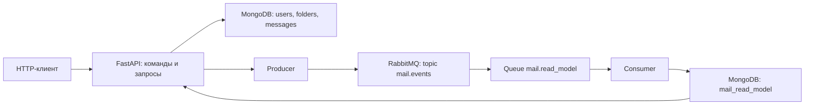

# Событийная архитектура — домашнее задание 06

Вариант 9: электронная почта. События сообщают о создании пользователя, папки
и письма. Они описывают уже произошедшие изменения, а команды запрашивают эти
изменения. Система сохраняет прежние восемь операций варианта и вход пользователя.

## События, команды и получатели

| Команда | HTTP-операция | Событие | Кто получает уведомление |
| --- | --- | --- | --- |
| CreateUser | `POST /api/v1/users` | UserCreated | Consumer модели чтения: публичная проекция пользователя |
| CreateFolder | `POST /api/v1/folders` | FolderCreated | Consumer модели чтения: проекция папки с владельцем |
| CreateMessage | `POST /api/v1/folders/{folder_id}/messages` | MessageCreated | Consumer модели чтения: проекция письма для поиска по коду |

События возникают только после успешной записи в MongoDB. Невалидные данные,
занятый логин, повторное имя папки и запрет доступа не создают событий.
Чтение сущностей и вход пользователя не публикуют события создания.
Создание письма означает сохранение в папке; отправка через SMTP к этой команде
не относится. Названия и payload всех событий приведены в [event_catalog.md](event_catalog.md).

## Компоненты и поток



API является producer. После записи он преобразует документ в публичный DTO
и вызывает `events/producer.py`. Пароли, хеши и токены в событие не включаются.
Producer открывает соединение, объявляет exchange/queue, включает publisher
confirms и публикует JSON с подходящим routing key. Успешный `201` возвращается
после подтверждения RabbitMQ. Это подтверждение приёма брокером, а не завершения
работы consumer.

`events/consumer.py` работает отдельным процессом. Он получает событие, проверяет
конверт и payload, записывает публичную проекцию в MongoDB и только затем
подтверждает обработку через `ack`. Приложение не ожидает выполнения этой записи.
В логах consumer видны тип события, event_id и результат `created`/`already applied`.

## RabbitMQ, exchange и routing

Выбран RabbitMQ: для трёх типов событий достаточно очереди и простого Python-
драйвера Pika. Kafka с partition и отдельным журналом для этой учебной задачи
не требуется. RabbitMQ запускается в Docker вместе с API, MongoDB и consumer.

| Настройка | Значение |
| --- | --- |
| Exchange | `mail.events`, тип `topic`, durable |
| Routing keys | `user.created`, `folder.created`, `message.created` |
| Queue | `mail.read_model`, durable |
| Binding | `*.created`: ровно один сегмент перед `.created` |
| Формат | JSON, UTF-8, `content_type=application/json` |
| Сохранение сообщений | `delivery_mode=2`, persistent |
| Подтверждение публикации | Publisher confirms и `mandatory=True` |
| Подтверждение обработки | Manual ack после записи проекции |
| Consumer prefetch | 1 сообщение без подтверждения |

Topic exchange направляет события по routing key. Один consumer подписан на все
три события. Если в будущем потребуется самостоятельный получатель уведомлений,
ему нужна отдельная очередь с нужными bindings: consumer одной очереди делят
сообщения между собой, а не получают по копии каждый.

Exchange и queue объявляются одинаково producer и consumer, поэтому producer
может работать, когда consumer остановлен. События будут ждать в очереди.
Имена можно задать через `EVENT_EXCHANGE` и `EVENT_QUEUE`; по умолчанию используются
значения из таблицы. `AMQP_URL` задаёт подключение к брокеру.

## Формат и гарантии доставки

Конверт содержит `event_id` (UUID), `event_type`, `version=1`, `occurred_at`
(ISO 8601 UTC) и `payload`. У RabbitMQ-сообщения `message_id` совпадает с event_id,
а `type` — с event_type. Примеры находятся в каталоге событий.

Для корректных событий, подтверждённых брокером, используется **at-least-once**:
consumer может получить сообщение повторно. Durable queue, persistent message
и volume сохраняют принятые события при обычном перезапуске RabbitMQ.
Один экземпляр брокера не защищает от потери самого диска.

Если consumer остановится до ack, RabbitMQ вернёт сообщение в очередь. Если
MongoDB временно недоступна, consumer выполняет `nack(requeue=True)` и завершает
процесс с ошибкой; Docker с `restart: on-failure` запускает его снова. Невалидный
JSON, неизвестный тип/версия и неверный payload отклоняются с
`nack(requeue=False)` и записью в лог, чтобы одно повреждённое сообщение не
останавливало очередь. Такие сообщения удаляются, поэтому для них гарантия
успешной обработки не применяется.

Повторная доставка безопасна: ключ проекции состоит из типа сущности и её UUID,
например `message:33333333-3333-4333-8333-333333333333`. Consumer использует
`update_one(..., {"$setOnInsert": ...}, upsert=True)`. Повторная обработка после
записи, но до ack, найдёт существующую проекцию и не создаст дубль.
Это идемпотентный результат обработки, а не exactly-once доставка.

Запись сущности в MongoDB и отправка в RabbitMQ не атомарны. Если запись прошла,
а публикация не была подтверждена, API возвращает `503` с явным сообщением
`Data saved, but event publication was not confirmed`. Данные уже сохранены;
событие могло не попасть в очередь либо попасть без получения подтверждения API.
Поэтому нельзя обещать at-least-once для каждой записи в БД при таком сбое.
После восстановления брокера сохранённую запись можно опубликовать повторно;
идемпотентность consumer защитит проекцию от дубликата. Пример восстановления
есть в README. Пользователь не должен считать `503` доказательством отсутствия
созданного объекта и слепо повторять создание.

## CQRS: команды и запросы

CQRS применим: почту читают чаще, чем создают папки и письма. Команды отвечают
за изменение данных, запросы — за получение ответа.

| Группа | Операции |
| --- | --- |
| Commands / write | Создание пользователя, папки и письма; вход создаёт сессию в памяти |
| Queries / read | Поиск пользователя по логину и маскам, списки папок и писем, письмо по коду |

Исходные коллекции `users`, `folders`, `messages` — write model и источник данных.
Например, исходное письмо содержит `content: {subject, body}`, `recipients`
и `size_bytes`. Consumer событий формирует отдельную read model:

```javascript
{
  _id: "message:33333333-3333-4333-8333-333333333333",
  entity_type: "message",
  data: {
    code: "33333333-3333-4333-8333-333333333333",
    folder_id: "22222222-2222-4222-8222-222222222222",
    subject: "Homework",
    body: "Project description.",
    recipient_address: "teacher@example.com",
    created_at: "2026-10-12T12:00:00Z"
  },
  event_id: "44444444-4444-4444-8444-444444444444",
  occurred_at: ISODate("2026-10-12T12:00:00Z"),
  applied_at: ISODate("2026-10-12T12:00:01Z")
}
```

В `mail_read_model` также сохраняются проекции `user:<id>` и `folder:<id>`.
`data` имеет плоскую структуру соответствующего ответа API. Запись — upsert
по `_id`, который MongoDB автоматически индексирует. Проекция появляется при
первом обработанном событии; отдельная инициализация коллекции не нужна.

Физическое разделение показано на `GET /api/v1/messages/{code}`. Endpoint сначала
ищет готовую проекцию письма. Если она отсутствует, читает исходное письмо:
это позволяет получать старые демонстрационные данные и новые письма сразу
после `201`, пока consumer ещё не обработал событие. В любом случае владелец
папки проверяется по актуальной коллекции `folders`.

Остальные GET используют исходные коллекции и прежние DTO. Разделение не
претендует на полную миграцию всех чтений. Кеш двух списков и rate limiting
задания 05 продолжают работать, инвалидация выполняется непосредственно после
записи команды. Consumer не меняет память отдельного процесса API.

Синхронизация асинхронная, поэтому read model имеет eventual consistency.
Consumer поддерживает события создания: после их обработки проекция соответствует
созданному объекту. Изменения через `mongosh` не публикуют события и могут
оставить проекцию устаревшей. В API нет команд обновления/удаления; соответствующие
события не вводятся. Документы, созданные до задания 06, автоматически не
переносятся в проекции; для их чтения работает fallback.

## Проверка взаимодействия

Тесты используют настоящие MongoDB и RabbitMQ с отдельными тестовыми базами,
exchange и очередями. Проверяются все три routing key, persistent JSON-сообщение,
подтверждение после записи, повторная доставка без дубля и возврат сообщения
в очередь при ошибке MongoDB. Повреждённые события проверяются отдельно.

API-тесты проверяют, что команды публикуют только публичные поля и не публикуют
события при конфликте, что `503` честно сообщает о сохранённых данных и сбрасывает
кеш, а GET письма использует проекцию с сохранением контроля владельца.
Инструкции запуска и ручной проверки находятся в README.

Проверка 12 октября 2026 года: все 47 тестов прошли. В Docker через HTTP
выполнены восемь операций варианта и вход, получены проекции всех трёх типов.
Проверены прежний кеш, отказ в чтении чужого письма и fallback для исходных
демонстрационных данных. При остановленном consumer новое событие осталось
в очереди и пережило перезапуск RabbitMQ. После запуска consumer появилась
проекция; повторная публикация того же письма не создала дубль.
