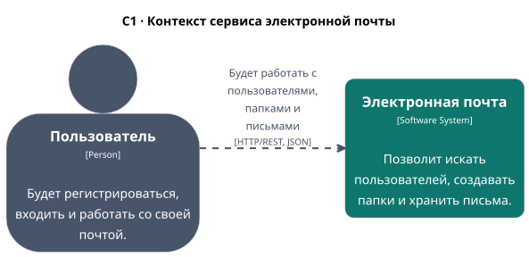
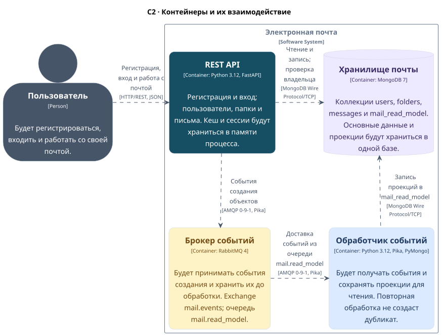
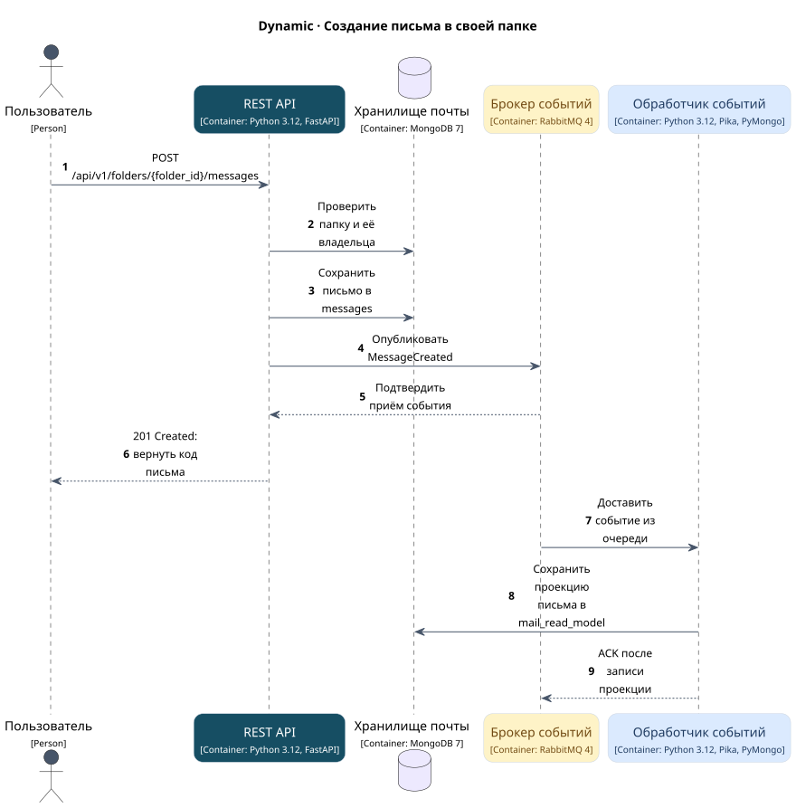

# ДЗ 1. План архитектуры электронной почты

## Текст задания

Нужно описать архитектуру выбранного варианта в Structurizr DSL: определить
роли, внешние системы, задачи пользователей, контейнеры, технологии и связи.
Понадобятся диаграммы System Context (C1), Container (C2) и одна Dynamic
для важного сценария. Результат — `readme.md` и `workspace.dsl`.

## Вариант 9

Электронная почта. Пример системы: https://outlook.live.com/.
В приложении будут пользователь, почтовая папка и сообщение.

API будет поддерживать восемь операций:

1. Создание нового пользователя.
2. Поиск пользователя по логину.
3. Поиск пользователей по маске имени и фамилии.
4. Создание новой почтовой папки.
5. Получение перечня папок пользователя.
6. Создание нового письма в папке.
7. Получение всех писем папки.
8. Получение письма по коду.

## Пользователи и границы системы

До входа посетитель сможет зарегистрироваться и получить токен.
После входа пользователь сможет искать других пользователей и работать
со своими папками и письмами. API будет проверять владельца папки.
На диаграммах оба состояния представлены одним участником «Пользователь».

Для запросов подойдут Postman или curl. Внешние интеграции не понадобятся:
Outlook указан как пример системы. Создание письма будет сохранять его в папке.

## Контейнеры

| Контейнер | Технология | За что будет отвечать |
| --- | --- | --- |
| REST API | Python 3.12, FastAPI | Восемь операций, вход, проверка данных и доступа, публикация событий |
| Хранилище почты | MongoDB 7 | Пользователи, папки, письма и проекции для чтения |
| Брокер событий | RabbitMQ 4 | Очередь событий создания объектов |
| Обработчик событий | Python 3.12, Pika, PyMongo | Получение событий и сохранение проекций |

В API также будут кеш списков папок и писем, сессии и ограничение попыток входа.
Они будут работать в памяти одного процесса. В MongoDB основные документы
и проекции будут находиться в разных коллекциях одной базы.

## Как будут взаимодействовать компоненты

Пользователь будет обращаться к API по HTTP с JSON. API будет читать и
сохранять данные в MongoDB через PyMongo. Создание пользователя, папки или
письма будет публиковать `UserCreated`, `FolderCreated` или `MessageCreated`
в RabbitMQ через Pika.

Обработчик будет получать события по AMQP и сохранять в `mail_read_model`
проекции — копии публичных данных в формате ответа API.
Получение письма по коду будет использовать проекцию,
а при её отсутствии — исходную запись. Владелец папки будет проверяться
в обоих случаях. Другие чтения будут обращаться к основным коллекциям.

## Сценарий: создание письма

Пользователь заранее войдёт в систему и получит токен.

1. Пользователь отправит запрос создания письма в своей папке.
2. API проверит токен, данные и владельца папки.
3. API сохранит письмо и сбросит кеш списка писем этой папки.
4. API опубликует `MessageCreated` в RabbitMQ.
5. RabbitMQ подтвердит приём события.
6. API вернёт `201 Created` с кодом письма.
7. RabbitMQ передаст событие обработчику.
8. Обработчик сохранит проекцию письма.
9. После записи обработчик подтвердит событие брокеру.

Обработка события будет идти независимо от HTTP-запроса: для ответа `201`
API будет ждать подтверждения брокера, а не готовности проекции.
Повторная доставка события не создаст второй документ проекции.

## Просмотр модели

Исходник всех трёх диаграмм — [workspace.dsl](workspace.dsl).
Для просмотра в VS Code подойдёт указанный в задании плагин
[Structurizr/C4](https://marketplace.visualstudio.com/items?itemName=vimpelcom.c4-varp).
Нужно открыть `workspace.dsl` и выбрать нужный view.
